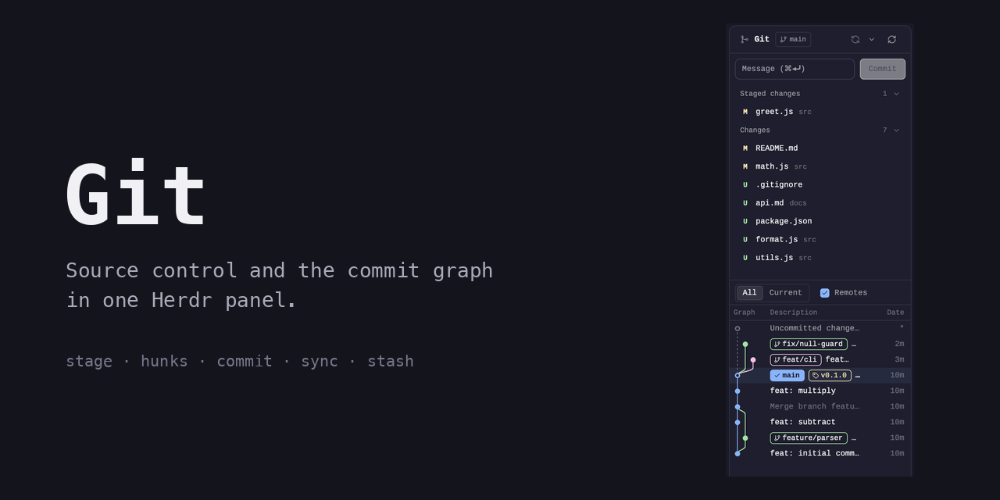
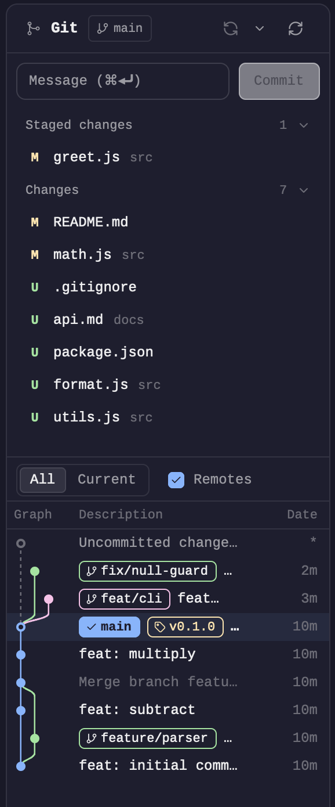
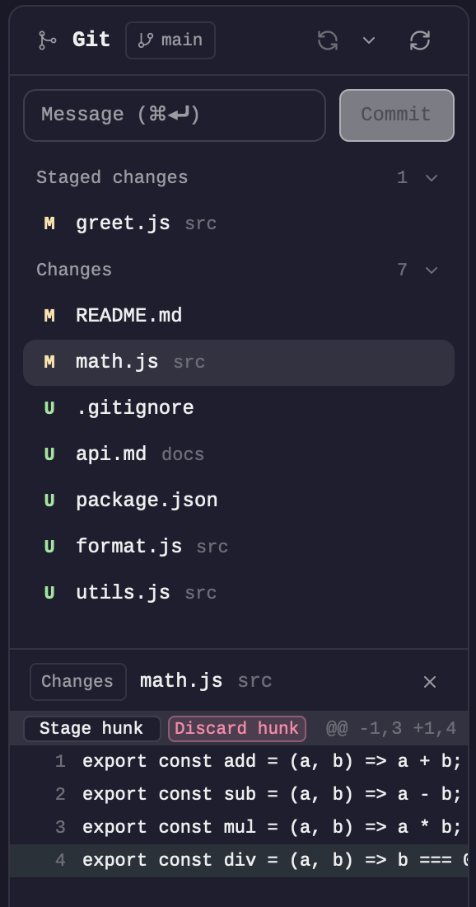

> **Moved to [h4ckm1n-dev/herdr-mods](https://github.com/h4ckm1n-dev/herdr-mods).** This repo is archived; install from there with `./install.sh`.

# Git

**Source control and the commit graph in one [Herdr](https://herdr.dev) panel.** Stage, unstage and discard files, stage single hunks, write the commit message, sync with the remote, switch branches and stash, with the commit graph always visible underneath. Never leave Herdr for the daily git loop.



<table>
<tr>
<td width="44%" valign="top"></td>
<td valign="top">

### What it does

**Top half, like VS Code's Source Control view**

- **Staged** and **Changes** groups with a status letter per file (`M` `A` `U` `D`, `!` for conflicts). Hover a row for **stage / unstage / discard**; hover a group header for the "all" buttons.
- A **commit box**: `⌘⏎` commits. With nothing staged, Commit stages everything first.
- A **sync button** with `↑ahead ↓behind`: pull (fast-forward only), then push. No upstream: Publish. Diverged: a dialog offers rebase or merge, and a conflict shows `!` files with Continue / Abort.
- A **branch picker** (filter, create, check out) and a menu for fetch, pull, push and **stash** (apply, pop, drop).

**Bottom half: the commit graph**, with lanes, branch / tag / remote labels, an uncommitted row, and right-click menus on branches, tags and commits.

Every destructive action asks first.

</td>
</tr>
</table>



Click a file and the graph gives way to its **diff**, with **Stage hunk / Discard hunk** (or **Unstage hunk**) on each `@@` header. `Esc` goes back to the graph; `↑` `↓` step through the files.

In a folder that isn't a repository but holds some, the panel lists them instead (Manygit).

## Install

Ask the agent in Herdr:

> add herdr.dev/mods/h4ckm1n-dev/herdr-git

Or do it by hand:

```sh
git clone https://github.com/h4ckm1n-dev/herdr-git
cp -R herdr-git/mods/git ~/.config/herdr-app/mods/
herdr-app check ~/.config/herdr-app/mods/git
```

The mod's `place` is `none`, so you decide where it goes. Add it to your layout's right-hand panel stack, next to Files:

```json
{ "id": "graph", "type": "block", "content": { "mod": "git" } }
```

**Needs:** Herdr app and `git`. It follows the repository of the focused terminal.

## Safe by design

- **Nothing is lost silently.** Discard, hunk discard, stash drop, mark-as-resolved, abort and pull all show a confirm dialog. Untracked files are called "Delete", not "Discard".
- **No hung prompts.** Fetch, pull and push run with `GIT_TERMINAL_PROMPT=0 GCM_INTERACTIVE=0 GIT_ASKPASS=`, so a credential prompt can't freeze the panel.
- **No stale actions.** If the branch or HEAD changed in a terminal since the panel drew, the action is refused instead of landing on the wrong commit. Stash actions check the stash's hash.
- **No polling.** The panel reads git again when the repo changes on disk, when focus, space or tab changes, after its own actions, and on the refresh button.
- **Conflicts can't be committed by accident.** Commit refuses while any file is unmerged.

## Privacy

Everything stays on your machine: the mod makes no network calls of its own. It **runs** `git` (and `sh` to apply a hunk) in the repository you're looking at; fetch, pull and push talk to your own remotes through git.

## Good to know

- No line-level staging, conflict-resolution editor, amend, blame or file history. The mod marks conflicted files and offers Continue / Abort; you resolve them in an editor.
- Herdr's `exec` has a 30 s limit, so a very slow `pull --rebase` can be cut off mid-rebase. The header then shows *Rebasing…* and Abort recovers.
- Hidden mods stay alive in Herdr; this one does nothing while hidden.

## Build it yourself

[`RECIPE.md`](RECIPE.md) describes the mod precisely enough for an agent to rebuild it from an empty folder: the layout, behaviour, what it's built from, its limits and how to check it works. `npm test` in `mods/git` runs the logic tests.

## Credits

Forked from [rabeeh-ta/herdr-git-graph](https://github.com/rabeeh-ta/herdr-git-graph) (MIT): the commit graph, its menus and the Manygit list are theirs. Icons are [Lucide](https://lucide.dev) (ISC). MIT licensed.
